# reTerminal E-ink Panels for Home Assistant

E-ink dashboards for Home Assistant, built with ESPHome:

- **reTerminal E1003** – Seeed's 10.3" touch e-ink panel with five pages: Home, Energy, Heating, Lights and Agenda, plus Plants and Settings.
- **reTerminal E1002 (colour)** – the single-page layout on Seeed's 7.3" colour e-ink, with one colour per utility: power black, water blue, heating red, solar green.
- **DIY panel** – a XIAO ESP32-C3 with a Waveshare 7.5" e-ink screen. The same single page in black and white, with rotating cards.

All of them show energy, solar, water, heating, plants, calendar and tasks. The E1003 adds smart controls for your lights and devices. Each feature is a separate Home Assistant package: install only what you use and delete the rest.

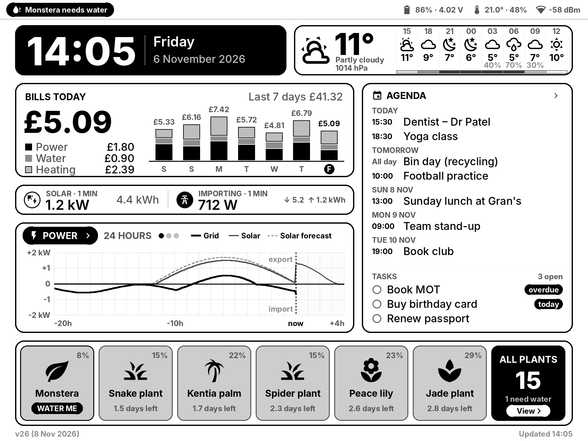

> The screenshots in this repo come from the panel's real display code with sample data.

---

## Contents

1. [What you get](#what-you-get)
2. [How it fits together](#how-it-fits-together)
3. [What you need](#what-you-need)
4. [Hardware](#hardware)
5. [What's in this repo](#whats-in-this-repo)
6. [Install – Home Assistant](#install--home-assistant)
7. [Install – ESPHome](#install--esphome)
8. [Using the reTerminal](#using-the-reterminal)
9. [Feature guides](#feature-guides) – [Weather](#weather) · [Energy](#energy) · [Solar](#solar) · [Water](#water) · [Heating](#heating) · [Plants](#plants) · [Tasks and calendar](#tasks-and-calendar) · [Smart controls](#smart-controls) · [Settings](#settings)
10. [The DIY panel](#the-diy-panel)
11. [The colour panel (reTerminal E1002)](#the-colour-panel-reterminal-e1002)
12. [reTerminal E1001 and TRMNL](#reterminal-e1001-and-trmnl)
13. [Voice commands](#voice-commands)
14. [Troubleshooting](#troubleshooting)
15. [Updating](#updating)
16. [Coming next](#coming-next)

---

## What you get

| | |
| --- | --- |
|  | **Home** – clock, weather with a solar strip, Bills Today (today's total and 7 days stacked by utility), a slim solar + grid strip, the last 24 hours of power, water or heating, agenda and the thirstiest plants. |
| 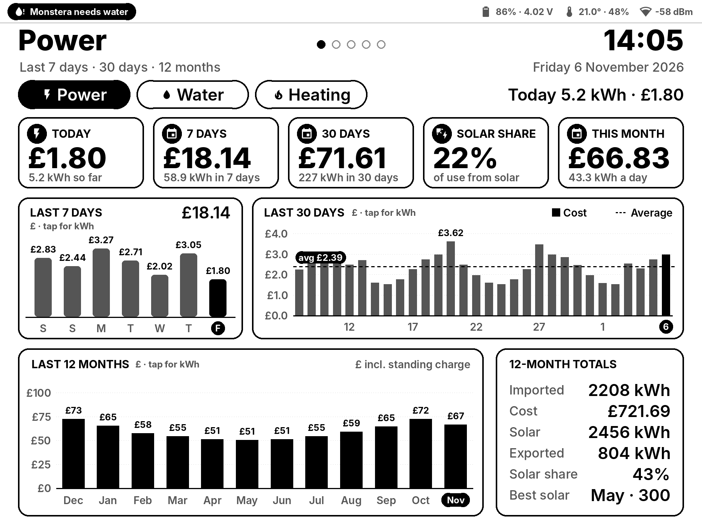 | **Energy** – Power, Water and Heating tabs. Shows today, 7 days, 30 days and this month, with 30-day and 12-month charts. Tap a chart to swap £ for kWh, litres or hours. Tap a figure to split usage from the standing charge. Tap Solar share for a battery size suggestion. |
| 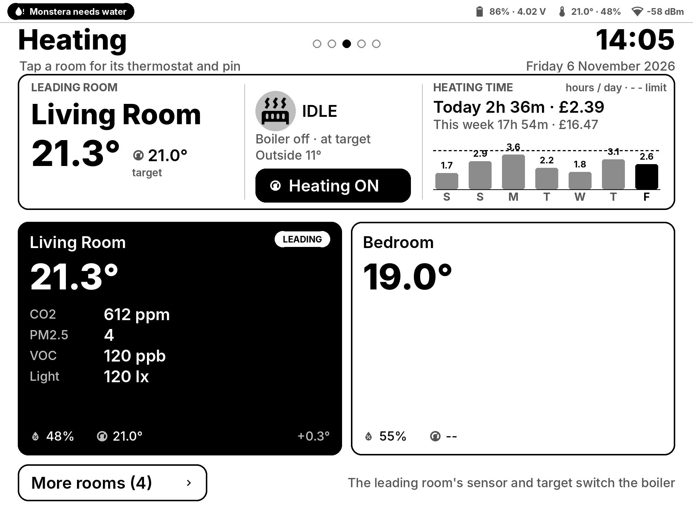 | **Heating** – your Home Assistant areas as room cards. Pick a leading room and a target. Shows boiler time and cost, with limits. |
| 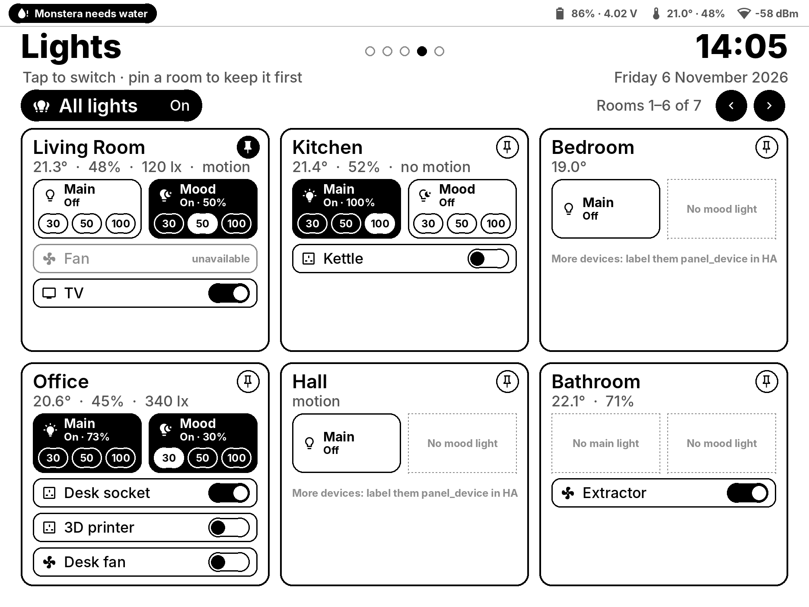 | **Lights** – a card per room with Main and Mood lights (30 / 50 / 100 %), up to 3 devices, and the room's sensors. An All lights switch sits at the top. Works both ways. |
| 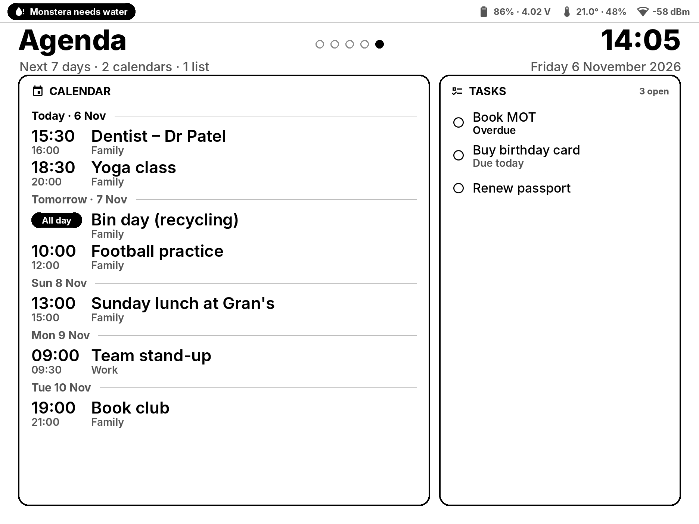 | **Agenda** – 7 days from all your calendars, and your open tasks. Tick tasks off on the panel. |
| 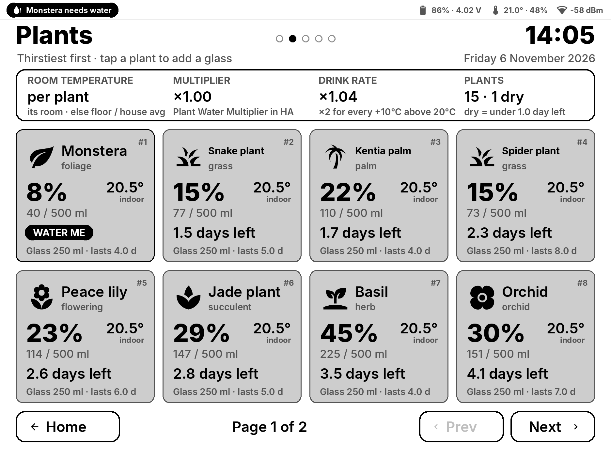 | **Plants** – up to 15 plants with virtual reservoirs that empty faster in warm rooms. Tap to water. |
| 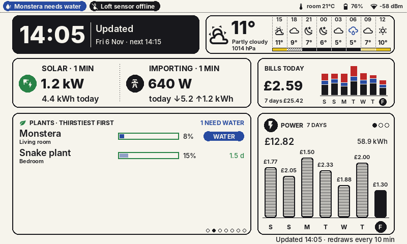 | **Colour panel (E1002)** – the single-page layout in colour, one colour per utility: power black, water blue, heating red, solar green. |
| 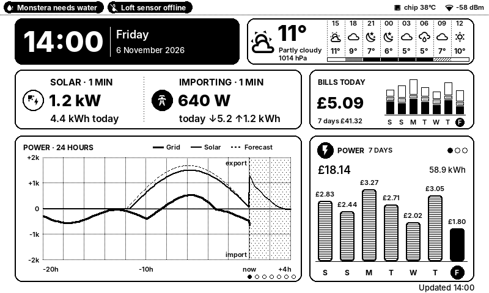 | **DIY panel** – the same data on one 800×480 screen, with rotating cards and deep sleep between refreshes. |

---

## How it fits together

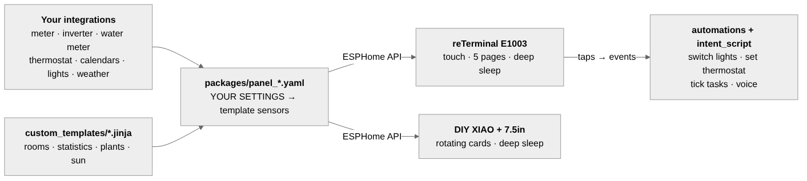

Home Assistant does the heavy lifting. Each `packages/panel_*.yaml` reads your own entities from its **YOUR SETTINGS** block and turns them into a handful of `sensor.panel_*` sensors. The panels subscribe to those sensors over the ESPHome API, so they don't need to know your meter, inverter or thermostat. Taps on the reTerminal go back as Home Assistant events and actions, and the automations in the packages handle them.

**Every panel works on its own.** Home Assistant keeps every setting and every piece of state the panels share: plant water levels and their drinking, the reservoir and warning sizes, the heating, electricity and water limits, the alerts, bills, night sleep and refresh times. You don't need an E1003: a DIY, E1001, E1002 or TRMNL panel on its own shows everything, and several panels always agree. The E1003 is simply a touch screen onto the same helpers. Anything you change in its Settings is written back to Home Assistant.

---

## What you need

- **Home Assistant 2025.1 or newer**, with the **ESPHome** add-on (or ESPHome running anywhere else).
- A **reTerminal E1003** for the full touch panel, and/or a 7.5" panel for the single-page layout: a **reTerminal E1001 / E1002**, **XIAO 7.5" ePaper Panel**, **TRMNL**, or a **XIAO ESP32-C3 + Waveshare 7.5" V2** (see [Hardware](#hardware)).
- Only for the features you want:

| Feature | You need |
| --- | --- |
| Weather | Any weather integration with an hourly forecast (Met.no works) |
| Energy | A live grid power sensor (W). Import / export kWh totals are optional |
| Solar | Inverter power (W) and lifetime energy (kWh). Forecast.Solar for the forecast |
| Water | A water meter total (L or m³, `total_increasing`) |
| Heating | A boiler relay, a Generic Thermostat helper, and room temperature sensors in your areas |
| Plants | Nothing. It's all virtual |
| Tasks and calendar | Any `calendar.*` and `todo.*` entities (Google, CalDAV, Local…) |
| Smart controls | Lights and switches in areas, plus three labels |

---

## Hardware

The panels don't care what brand your meter or thermostat is. If it shows up in Home Assistant as an entity, it will work. Below is what I used, and a few tried and tested options if you're starting from zero.

### The displays

The reTerminal E Series is what this project is built around. They're ready-made, with a case, battery, buttons and ESPHome support out of the box, so there's no soldering and no 3D printing.

**Recommended: reTerminal E Series**

| Device | What it is | Firmware | Link |
| --- | --- | --- | --- |
| **reTerminal E1003** ⭐ | 10.3" touch e-ink, 1872×1404, battery, buttons, buzzer and mic. The full multi-page panel | `reterminal-e1003-energy.yaml` | [Buy](https://www.seeedstudio.com/reTerminal-E1003-p-6731.html?sensecap_affiliate=rZDALM2&referring_service=link) · [With frame](https://www.seeedstudio.com/reTerminal-E1003-frame-bundle.html?sensecap_affiliate=rZDALM2&referring_service=link) · [Wiki](https://wiki.seeedstudio.com/getting_started_with_reterminal_e1003/) |
| **reTerminal E1001** | 7.5" monochrome e-ink, 800×480, battery and buttons | Single-page layout (`reterminal-e1001.yaml`) | [Buy](https://www.seeedstudio.com/reTerminal-E1001-p-6534.html?sensecap_affiliate=rZDALM2&referring_service=link) · [Wiki](https://wiki.seeedstudio.com/getting_started_with_reterminal_e1001/) |
| **reTerminal E1002** | 7.3" colour e-ink (Spectra 6), 800×480, battery and buttons | Colour single-page layout (`reterminal-e1002-color.yaml`) | [Buy](https://www.seeedstudio.com/reTerminal-E1002-p-6533.html?sensecap_affiliate=rZDALM2&referring_service=link) · [Wiki](https://wiki.seeedstudio.com/reterminal_e10xx_main_page/) |

> The E1003 is the only one with touch, and the multi-page layout relies on it. The E1001 and E1002 run the 800×480 single-page layout.
>
> **E1001 or E1002?** The E1002 has its own [colour version](#the-colour-panel-reterminal-e1002) of the layout, ready to install. Colour e-ink takes about 20 seconds per refresh, against a few seconds for black and white. For a panel that sleeps between refreshes that doesn't matter, but if you want it updating every minute, the E1001 is the better pick.

**Also supported (optional): other 7.5" panels**

These have the same 800×480 resolution as the DIY panel, so they use the single-page layout too.

| Device | What it is | Link |
| --- | --- | --- |
| **XIAO 7.5" ePaper Panel** | XIAO ESP32-C3 + 7.5" e-ink in a ready-made case with a battery | [Buy](https://www.seeedstudio.com/XIAO-7-5-ePaper-Panel-p-6416.html?sensecap_affiliate=rZDALM2&referring_service=link) · [Wiki](https://wiki.seeedstudio.com/xiao_075inch_epaper_panel/) |
| **TRMNL 7.5" (OG) DIY Kit** | 7.5" e-ink, driver board, XIAO ESP32-S3 Plus and battery. Bring your own case. Ready-made firmware: `trmnl-7in5-diy.yaml` | [Buy](https://www.seeedstudio.com/TRMNL-7-5-Inch-OG-DIY-Kit-p-6481.html?sensecap_affiliate=rZDALM2&referring_service=link) · [ESPHome wiki](https://wiki.seeedstudio.com/ogdiy_kit_works_with_esphome/) |
| **TRMNL (OG)** | TRMNL's own ready-made 7.5" e-ink display (ESP32-C3). Replaces TRMNL's firmware with ESPHome. Ready-made firmware: `trmnl-og.yaml` | [usetrmnl.com](https://usetrmnl.com/) |
| **Seeed XIAO ESP32-C3 + Waveshare 7.5" V2** | My original DIY build | [XIAO ESP32-C3](https://www.seeedstudio.com/Seeed-XIAO-ESP32C3-p-5431.html?sensecap_affiliate=rZDALM2&referring_service=link) · [Waveshare 7.5" e-Paper](https://www.waveshare.com/wiki/7.5inch_e-Paper_HAT_Manual) |

> **Ready-made firmware:** the reTerminal E1001, the reTerminal E1002, the TRMNL DIY Kit and the TRMNL OG each have their own YAML with the right board, screen pins, battery reading and a refresh button. The XIAO 7.5" ePaper Panel and newer TRMNL models don't have one yet. Start from `xiao-esp32-eink.yaml` and check the `esp32:` board and the `display:` / `spi:` pins against the ESPHome page in your device's wiki.

*Links to seeedstudio.com are affiliate links. They cost you nothing extra and help support NotEnoughTech.*

### Weather

| | |
| --- | --- |
| **Used** | [Met.no](https://www.home-assistant.io/integrations/met/) – free, no account, no hardware |
| **Suggested** | Any weather integration with an hourly forecast: [OpenWeatherMap](https://www.home-assistant.io/integrations/openweathermap/), [Met Office](https://www.home-assistant.io/integrations/metoffice/) (UK), [Pirate Weather](https://github.com/Pirate-Weather/pirate-weather-ha) |

### Energy

| | |
| --- | --- |
| **Used** | <!-- add your grid meter / CT clamp here --> |
| **Suggested** | [Shelly Pro 3EM](https://shelly.com/blogs/documentation/shelly-pro-3em) or Shelly EM – CT clamps on the mains, live W with sign, local [Shelly integration](https://www.home-assistant.io/integrations/shelly/) |
| | [Home Assistant Glow](https://github.com/klaasnicolaas/home-assistant-glow) – ESPHome LED pulse reader for meters with a blinking LED, cheap DIY |
| | UK smart meters: a Glow IHD/CAD ([Hildebrand](https://glowmarkt.com/)) or an [Octopus Home Mini](https://www.home-assistant.io/integrations/octopus_energy/) for near-live readings without touching the wiring |

### Solar

| | |
| --- | --- |
| **Used** | <!-- add your inverter here --> + [Forecast.Solar](https://www.home-assistant.io/integrations/forecast_solar/) |
| **Suggested** | Most inverters have an integration: [SolarEdge](https://www.home-assistant.io/integrations/solaredge/), [Enphase Envoy](https://www.home-assistant.io/integrations/enphase_envoy/), [Fronius](https://www.home-assistant.io/integrations/fronius/), [GivEnergy](https://github.com/GivEnergy/giv_tcp), [Solax](https://www.home-assistant.io/integrations/solax/) |
| | No integration? A Shelly EM clamp on the inverter's AC output gives you power and kWh |
| | [Solcast](https://github.com/BJReplay/ha-solcast-solar) works in place of Forecast.Solar |

### Water

| | |
| --- | --- |
| **Used** | <!-- add your water meter reader here --> |
| **Suggested** | [AI-on-the-edge-device](https://github.com/jomjol/AI-on-the-edge-device) – an ESP32-CAM that reads the dial on your meter. No plumbing |
| | Meters with a pulse output or magnetic dial: an ESPHome [pulse meter](https://esphome.io/components/sensor/pulse_meter.html) with a reed switch or hall sensor |
| | Inline flow meters (Flume, Shelly + flow sensor) if you can get to the pipe |

### Heating

| | |
| --- | --- |
| **Used** | A boiler relay switched from Home Assistant, a [Generic Thermostat](https://www.home-assistant.io/integrations/generic_thermostat/) helper, and a temperature + humidity sensor in every room |
| **Suggested relay** | A Shelly 1 / Shelly 1 Mini (dry contact – check your boiler's call-for-heat terminals), a Sonoff relay flashed with ESPHome, or your existing smart thermostat ([Tado](https://www.home-assistant.io/integrations/tado/), [Nest](https://www.home-assistant.io/integrations/nest/), [Hive](https://www.home-assistant.io/integrations/hive/)) |
| **Suggested sensors** | Zigbee temp/humidity sensors (Aqara, Sonoff SNZB-02 series) via [ZHA](https://www.home-assistant.io/integrations/zha/) or Zigbee2MQTT, or Xiaomi LYWSD03MMC over [BTHome](https://www.home-assistant.io/integrations/bthome/) |

> ⚠️ Boiler wiring is mains voltage. If you're not sure, get an electrician or heating engineer to fit the relay.

### Plants

| | |
| --- | --- |
| **Used** | Nothing – the reservoirs are virtual, driven by room temperature |
| **Suggested** | Nothing yet. Smart soil sensors are on the [Coming next](#coming-next) list |

### Tasks and calendar

| | |
| --- | --- |
| **Used** | Calendar and to-do integrations already in Home Assistant |
| **Suggested** | [Google Calendar](https://www.home-assistant.io/integrations/google/), [Google Tasks](https://www.home-assistant.io/integrations/google_tasks/), [CalDAV](https://www.home-assistant.io/integrations/caldav/) (iCloud, Nextcloud), [Local Calendar](https://www.home-assistant.io/integrations/local_calendar/), [Local To-do](https://www.home-assistant.io/integrations/local_todo/), [Todoist](https://www.home-assistant.io/integrations/todoist/) |

### Smart controls

| | |
| --- | --- |
| **Used** | Lights and devices already in Home Assistant, tagged with labels |
| **Suggested lights** | [Philips Hue](https://www.home-assistant.io/integrations/hue/), IKEA, Aqara or any Zigbee bulbs via ZHA / Zigbee2MQTT, [WLED](https://www.home-assistant.io/integrations/wled/) strips |
| **Suggested devices** | Smart plugs and relays ([Shelly](https://www.home-assistant.io/integrations/shelly/), [TP-Link Kasa / Tapo](https://www.home-assistant.io/integrations/tplink/)), fans, TVs, blinds |
| **Room sensors** | Any motion, lux, temperature and humidity sensors in the area (Aqara FP2 / P2, Hue motion sensor) |

### Settings and voice

| | |
| --- | --- |
| **Used** | Nothing extra – the E1003 has the mic, buzzer and battery built in |
| **Suggested** | The [Speech-to-Phrase](https://github.com/OHF-voice/speech-to-phrase) add-on for fast, local voice commands, or [Whisper](https://www.home-assistant.io/integrations/wyoming/) |

---

## What's in this repo

```
homeassistant/
├── configuration.yaml          loads the packages (merge into yours)
├── packages/                   one file per feature – edit YOUR SETTINGS in each
│   ├── panel_core.yaml         weather, rooms, voice, recorder, DIY panel helpers (always)
│   ├── panel_energy.yaml       grid, prices, history, power chart
│   ├── panel_solar.yaml        solar totals and the 4-hour forecast
│   ├── panel_water.yaml        water meter, tariff, history
│   ├── panel_heating.yaml      thermostat, boiler time and cost, limits, voice
│   ├── panel_plants.yaml       15 plants: name, icon, room, watering
│   ├── panel_agenda.yaml       calendars and to-do lists
│   └── panel_lights.yaml       Lights page: rooms, lights, devices, All lights
├── custom_templates/           shared Jinja macros the packages import
│   ├── panel_rooms.jinja       rooms from areas (heating, plants, lights)
│   ├── panel_stats.jinja       hourly / daily / monthly statistics
│   ├── panel_plants.jinja      plant table and room temperatures
│   ├── panel_bills.jinja       £ per day for every panel (Bills Today, 7-day bills)
│   └── panel_sun.jinja         daylight and cloud score for the solar strip
├── custom_sentences/en/
│   └── panel.yaml              voice commands
└── cards/                      dashboard cards to paste in (not loaded by HA)
    ├── prices-card.yaml        energy, water and heating prices and limits
    ├── plants-card.yaml        plant names, icons, rooms, watering
    └── panels-card.yaml        every panel: status, battery, refresh, card change, stay awake
esphome/
├── reterminal-e1003-energy.yaml
├── reterminal-e1001.yaml        reTerminal E1001 (black and white)
├── reterminal-e1002-color.yaml  reTerminal E1002 (colour)
├── trmnl-7in5-diy.yaml          TRMNL 7.5" (OG) DIY Kit
├── trmnl-og.yaml                TRMNL OG (TRMNL's own device)
└── xiao-esp32-eink.yaml
```

Every file is heavily commented. Use those comments to find your way around rather than reading this README line by line.

---

## Install – Home Assistant

### 1. Copy the files

Copy `packages/`, `custom_templates/` and `custom_sentences/` into your Home Assistant config folder (`/config`). The Samba share, Studio Code Server and the File editor add-on all work.

If you're starting from scratch, use the `configuration.yaml` from this repo. Otherwise, add the packages line to yours:

```yaml
homeassistant:
  packages: !include_dir_named packages
```

### 2. Keep only what you use

Delete the packages you don't need, or rename them to `.yaml.off`. `panel_core.yaml` always stays. Each package's header lists the other files it needs.

### 3. Edit YOUR SETTINGS

Every package starts with the same block. It's the only part you have to touch:

```yaml
# ── YOUR SETTINGS ──────────────────────────────
homeassistant:
  customize:
    sensor.panel_water_settings:
      water_meter:    &water_meter     sensor.water_meter_total
```

The values are saved as attributes of a small `sensor.panel_*_settings` sensor, and the rest of the package reads them from there. Change the entity after the `&name:` and leave the `&name` itself alone.

### 4. Restart

New packages and new `.jinja` files need a full restart. A template reload won't do.

### 5. Add the dashboard cards

Go to Dashboard → ⋮ → Edit → **+ Add card** → **Manual**, and paste in each file from `cards/`:

- `prices-card.yaml` – electricity price and standing charge, water tariff, boiler cost per hour, and the alerts: electricity (kWh) and water (litres) per day, week and month, heating time or budget per day, week and month, plus an "Alerts now" row. These helpers drive every panel. If you have an E1003, its Settings → Alerts stays in sync with them.
- `plants-card.yaml` – name, icon, room, glass size, days per glass, water left and a **Water** button for each plant, plus the reservoir size and warning for all of them, and a list of the thirstiest.
- `panels-card.yaml` – all your panels in one card: Wi-Fi, battery, room temperature and when each last checked in, plus refresh rate, card change and stay awake for every panel without a touch screen. Delete the blocks for panels you don't have.

### How each package is laid out

| Section | Responsible for |
| --- | --- |
| Header | What the feature does, the files it needs, how to switch it off |
| YOUR SETTINGS | Your entities, kept as attributes of `sensor.panel_*_settings` |
| `input_number` / `input_select` / `input_boolean` | Prices, limits and options you change from a dashboard |
| `template:` | The sensors the panels read: history, today's figures, rooms, forecasts |
| `sensor:` / `utility_meter:` | Totals and daily resets where needed |
| `automation:` / `intent_script:` | Panel taps, thermostat sync and voice commands |

---

## Install – ESPHome

### 1. Secrets

Add these to your ESPHome `secrets.yaml`:

```yaml
wifi_ssid: "YourWiFi"
wifi_password: "YourPassword"
fallback_password: "setup-hotspot-password"
reterminal_e1003__encryption_key: "…"     # 32-byte base64, ESPHome generates one for a new device
reterminal_e1003__ota_password: "…"
reterminal_diy__encryption_key: "…"
reterminal_diy__ota_password: "…"
reterminal_e1002__encryption_key: "…"
reterminal_e1002__ota_password: "…"
reterminal_e1001__encryption_key: "…"
reterminal_e1001__ota_password: "…"
trmnl_diy__encryption_key: "…"
trmnl_diy__ota_password: "…"
trmnl_og__encryption_key: "…"
trmnl_og__ota_password: "…"
```

### 2. Substitutions

Open the ESPHome YAML and edit the `substitutions:` block at the top:

- **Top row layout** – `top_layout: "split"` (the default) gives you a clock card on the left half and a bordered weather card on the right with the current weather and the 3-hour forecast. `"wide"` puts the current weather inside the clock card (2/3 of the width) with the forecast on the right. Same option on every panel.
- **Feature switches** – `feature_energy`, `feature_solar`, `feature_water`, `feature_heating`, `feature_agenda` and `feature_plants` on the E1003 (these are first-boot defaults; you can change them later in Settings → Features). On the DIY panel they're called `show_*`. Match them to the packages you installed.
- **Entities** – grid power, import / export totals, solar, water, your thermostat, and an indoor temperature sensor for the plants.

### 3. Install

Copy the YAML into `/config/esphome`, then go to the ESPHome dashboard → **Install**. The first install goes over USB; after that it's over Wi-Fi.

### 4. Allow actions

Go to Settings → Devices & services → ESPHome → your panel → **Configure** and tick **Allow the device to perform Home Assistant actions**. Touch controls, heating, lights and ticking tasks off all need it.

### 5. First boot

If the E1003 can't find a known Wi-Fi network, it starts a **reTerminal E1003 Setup** hotspot and shows a QR code. Scan the code, pick your network, and you're done. You can add more networks later from Settings → Device.

---

## Using the reTerminal

| Button | Press | Hold |
| --- | --- | --- |
| Left / right | Previous / next page (it wraps around, so keep pressing) | Settings |
| Green | Full refresh (and wake up from sleep) | Home page |

The page loop is **Energy → Home → Heating → Lights → Agenda**. Pages for features you've switched off are skipped. The Lights page appears once Home Assistant has at least one room for it.

The footnote on Home tells you when the screen was last updated, plus the firmware version on the left. If you're ever unsure what's installed, check that version tag.

---

## Feature guides

Each guide follows the same pattern: what you get, which files, setup steps, and what each section of the package does.

### Weather

The current conditions, plus the next 24 hours in 3-hour slots: icon, temperature, rain chance and a cloud score. With solar on, a strip under the slots shades each slot by expected sunshine.

**Files:** `panel_core.yaml`, `panel_sun.jinja`

1. Add a weather integration with an hourly forecast (Met.no is fine).
2. Set `weather:` in `panel_core.yaml` → YOUR SETTINGS.
3. Restart, then check that `sensor.weather_forecast_3h` has a `slots` attribute.

| Section | Responsible for |
| --- | --- |
| YOUR SETTINGS | Weather entity, and the E1003's ESPHome name (used by voice and instant refreshes) |
| Weather: next 24 h in 3 h steps | Calls `weather.get_forecasts` and packs 8 slots |
| `panel_sun.jinja` | Daylight and cloud score for the solar strip |

### Energy


Live import and export, today's kWh and cost, Bills Today, the 24-hour power chart, and the Power tab of the Energy page.

**Files:** `panel_energy.yaml`, `panel_stats.jinja`, `cards/prices-card.yaml`

1. Set `grid_power:` to your live grid power in W: positive means importing, negative means exporting.
2. If you have import and export kWh totals from a meter, set `grid_import_energy:` and `grid_export_energy:`. If not, leave them alone and the package builds both from `grid_power`.
3. Enter your price per kWh and daily standing charge in the prices card.
4. Use the same entities in the ESPHome `substitutions:`.

| Section | Responsible for |
| --- | --- |
| YOUR SETTINGS | Grid power and kWh totals |
| `input_number` | Price, standing charge, weekly day helpers |
| Grid import / export power | Splits the signed power sensor in two |
| Monthly, lifetime, peak sensors | For your own dashboards |
| Energy history (30 days + 12 months) | Statistics for the Energy page and Bills Today |
| Last 20 hours of power | The power chart, kept across reboots |
| `sensor:` (integration) | kWh totals made from power |

**Energy page tricks**

- Tap a chart to switch between £ and kWh.
- Tap **7 days**, **30 days** or **This month** to split energy cost from the standing charge.
- Tap **Solar share** to get a battery size suggestion based on a year of exported solar.

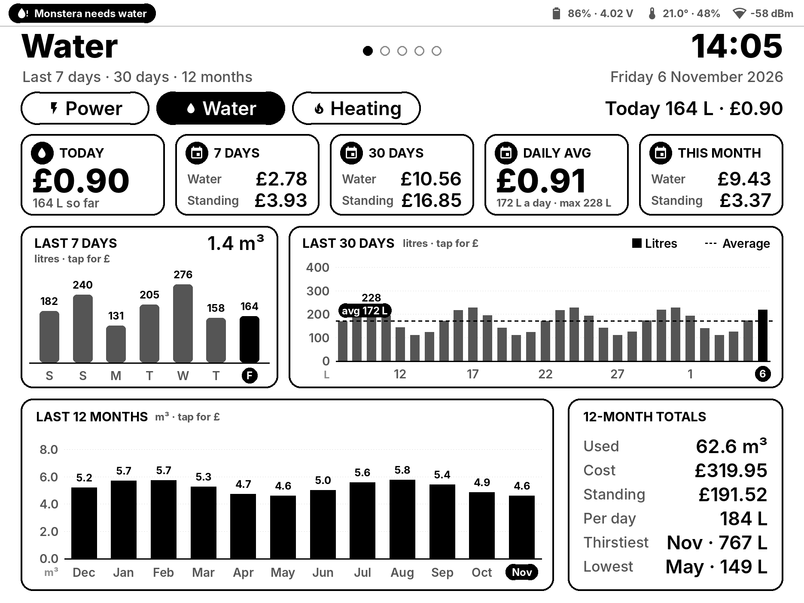

### Solar

Adds the live 1-minute average and today's generation to the solar + grid strip, solar bars to the charts, solar share, the battery suggestion, and the 4-hour forecast.

**Files:** `panel_solar.yaml` (needs `panel_energy.yaml`)

1. Set `solar_power:` (W) and `solar_energy:` (kWh lifetime).
2. Add Forecast.Solar and point the three forecast lines at its sensors. Solcast works too.
3. Leave the solar feature on in ESPHome.

| Section | Responsible for |
| --- | --- |
| YOUR SETTINGS | Solar power, energy and forecast sensors |
| Monthly + lifetime solar | Dashboard sensors |
| Solar forecast: next 4 hours | 8 half-hour steps for the chart and the strip |
| `utility_meter` | Monthly solar total |

No solar? Delete the file and switch the feature off. The power chart then shows the grid line only.

### Water

Litres today, the 24-hour water chart, water in Bills Today, the Water tab of the Energy page, and usage alerts.

**Files:** `panel_water.yaml`, `panel_stats.jinja`, `cards/prices-card.yaml`

1. Set `water_meter:` to your meter's running total (the one your Energy dashboard uses).
2. Create `water_price` (£/m³) and the two yearly standing charges, either in Settings → Helpers or by uncommenting the block in the package. Do one or the other, not both.
3. Fill in the prices card.

| Section | Responsible for |
| --- | --- |
| YOUR SETTINGS | Water meter |
| Water tariff | Optional price and standing charge helpers |
| Water history | Hourly, daily and monthly litres |
| Water used today | The sensor both panels read |
| `utility_meter` | Midnight reset |

### Heating


Room cards come from your areas. The leading room you pick decides when the boiler fires. You also get boiler time and cost, limits, and voice control.

**Files:** `panel_heating.yaml`, `panel_core.yaml`, `panel_rooms.jinja`

1. Create a **Generic Thermostat** helper for the boiler relay and set its sensor to `sensor.heating_leading_temperature`.
2. Set `thermostat:` and `boiler_relay:` in YOUR SETTINGS.
3. Put room temperature sensors in the right areas. Use the `panel_sensor` label to pick one when a room has several, and `panel_ignore` to skip a sensor.
4. Set the boiler cost per hour in the prices card, and `thermostat:` in the E1003 substitutions.

| Section | Responsible for |
| --- | --- |
| YOUR SETTINGS | Thermostat and boiler relay |
| `input_number` / `input_select` | Cost per hour, limits, limit by time or £ |
| Heating Leading Temperature | The leading room's temperature for the thermostat |
| Panel Heating State | Pins, targets and leading room set on the panel |
| Boiler Active + history | Run time per hour, day and month |
| `history_stats` | Boiler hours today, this week, last 6 days |
| Automations | Thermostat ↔ panel sync |
| `intent_script` | "Heating on / off", "set heating to 21" |

### Plants


Up to 15 plants with a virtual reservoir each. It empties based on glass size, days per glass and room temperature. Home Assistant keeps the levels and drains them every 5 minutes, so every panel shows the same numbers, with or without an E1003. When you water a plant, tap it on the E1003 or press **Water** on the plants card.

**Files:** `panel_plants.yaml`, `panel_plants.jinja`, `cards/plants-card.yaml`

1. Restart, and 15 sample plants appear.
2. Use the plants card to set the name, icon, room, glass size and days per glass. Type `-` as a name to hide a plant.
3. Set **Reservoir** (glasses) and **Warn when less than** (days) under **All plants** on the same card. They're 2 glasses and 1 day to start with. On the E1003 they're also in Settings → Plants.
4. Pick each plant's room on the card, or long-press a plant on the E1003. A plant drinks faster in a warm room.

| Section | Responsible for |
| --- | --- |
| `input_number` | Glass size, days per glass, global multiplier, **water left per plant**, reservoir size, warning |
| `script.panel_water_plant` | Waters a plant (`plant: 1…15`, `glasses:`), never over the reservoir. Use it in your own buttons or NFC tags |
| `sensor.panel_plants_needing_water` | How many need water, the 5 thirstiest (read by every panel) and every plant as JSON |
| `input_select` / `input_text` | Icon and name |
| `input_button` | Reload the samples |
| Which room each plant is in | Rooms from areas, and the temperature behind thirst |
| Automations | Samples on first start, the plants drinking every 5 minutes |

> **Updating from an older E1003 firmware (v27 or earlier)?** The E1003 used to keep the water levels itself. After you install v28, it hands its levels, reservoir size and warning to Home Assistant the first time it connects, but only for plants that don't have a level yet. From then on Home Assistant keeps them.

### Tasks and calendar


Seven days of events from every calendar you list, next to your open tasks. Ticking a task off on the E1003 marks it done in its list.

**Files:** `panel_agenda.yaml`

1. Add calendar and to-do integrations (Google Calendar and Tasks, CalDAV, Local Calendar, Local To-do, shopping list…).
2. List them in YOUR SETTINGS: `calendars: [calendar.family, calendar.work]` and `todo_lists: [todo.my_tasks]`.
3. Restart.

| Section | Responsible for |
| --- | --- |
| YOUR SETTINGS | Calendars and to-do lists |
| Agenda | `calendar.get_events` + `todo.get_items`, packed for the panels |

### Smart controls


A card per room: Main and Mood lights with 30 / 50 / 100 % brightness, up to 3 devices, and temperature, humidity, light level and motion. Pinned rooms come first. An All lights switch sits at the top. Everything works both ways.

**Files:** `panel_lights.yaml`, `panel_rooms.jinja`

You assign devices with Home Assistant **labels**, so there's no YAML to edit:

1. Settings → Areas, labels & zones → **Labels** → create `panel_main_light`, `panel_mood_light` and `panel_device`.
2. Make sure every light and device is in the right area.
3. Open each entity → ⚙ → **Labels** and tag it. Use `panel_device` for up to 3 extras per room: a fan, socket, TV or blinds.
4. Untagged rooms still show up: a light group (or the first light) becomes Main.
5. Optional: set `all_lights:` to a light group or switch. Left empty, All lights uses every Main and Mood light.

| Section | Responsible for |
| --- | --- |
| YOUR SETTINGS | Entity behind All lights |
| Panel Lights State | Pinned rooms |
| Panel Lights | Rooms, lights, devices, brightness and sensors, live |
| Automation | Panel taps: on / off, brightness, All lights |

Brightness levels only appear on lights that can dim. The panel sends `light.turn_on` with `brightness_pct`, so light groups pass the level on to every member.

### Settings

| General | Alerts |
| --- | --- |
| 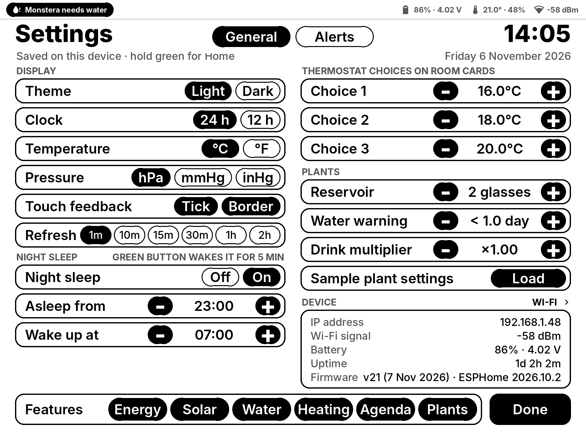 | 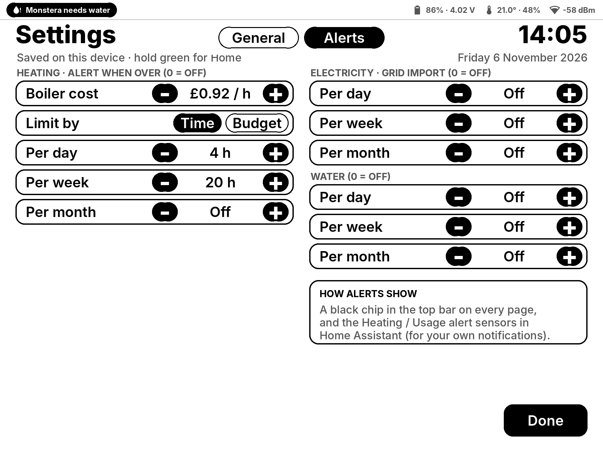 |

Hold left or right to open Settings. Use **Done**, or hold green, to leave.

**General tab**

| Section | Responsible for |
| --- | --- |
| Display | Theme, 12 / 24 h clock, touch feedback (tick or border) |
| Refresh | Every minute, or 10 / 15 / 30 min or 1 / 2 h with deep sleep between refreshes |
| Night sleep | On / off, **Asleep from** and **Wake up at** (30-minute steps) |
| Thermostat choices | Targets offered on room cards |
| Plants | Reservoir, warning level, drink multiplier |
| Device | Battery, Wi-Fi, firmware. Tap it to add a Wi-Fi network |
| Features | Switch pages and cards on and off |

**Alerts tab**

| Section | Responsible for |
| --- | --- |
| Heating | Cost per hour, and limits per day, week and month (time or £) |
| Electricity | Import kWh per day, week and month |
| Water | Litres per day, week and month |

Go over a limit and a black chip appears in the top bar of every panel. Home Assistant works the alerts out itself, as `sensor.panel_heating_alert` and `sensor.panel_usage_alert` (empty means all fine), so they work without an E1003, and you can use them for your own notifications. The limits are Home Assistant helpers: set them here or on the prices card, and the other side follows.

**Sleep mode**

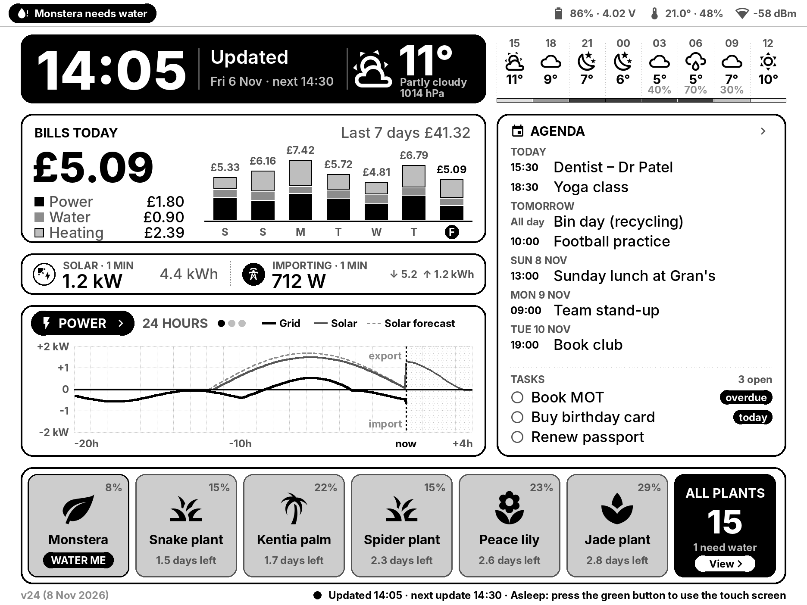

With any refresh rate other than 1 minute, the panel wakes on the 10, 15 or 30-minute (or hourly) marks, draws Home, and goes back to sleep. The clock then shows when the screen was last updated, and the footnote says when the next update is due. Press green to wake it and use the touch screen. It goes back to sleep 2 minutes after your last touch. Updates over Wi-Fi only work while it's awake.

**Night sleep**

Switch on **Night sleep** in Settings and pick when it goes to sleep and wakes up. Between those times the panel doesn't refresh at all: it draws Home one last time, with **Night sleep · back at 07:00** next to the clock and the same in the footnote, then sleeps until the morning. Press green during the night and it wakes up for you, then goes back to sleep 5 minutes after your last touch. Night sleep works with any refresh setting, including every minute.

---

## The DIY panel

| | |
| --- | --- |
| 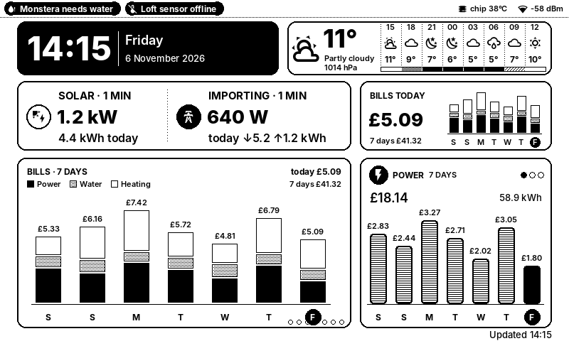 | 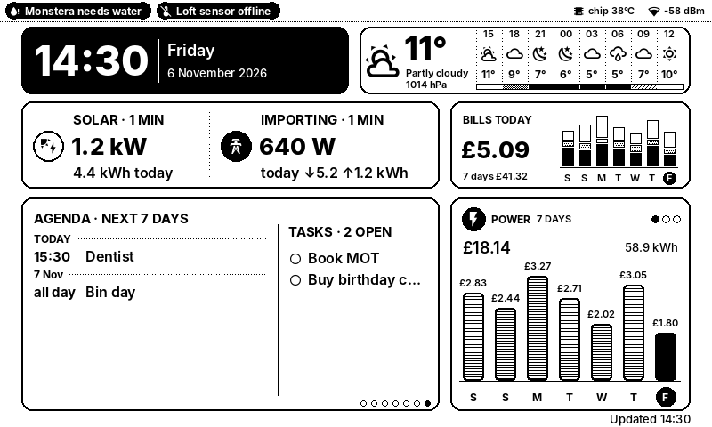 |
|  | 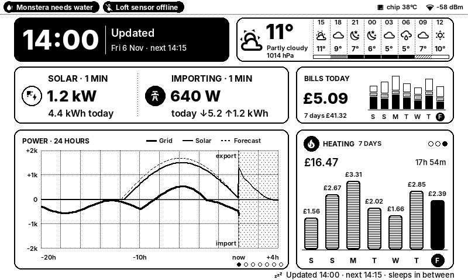 |

The DIY panel has no touch screen, so it does everything on its own:

- The top row shows solar + grid (1-minute averages) and Bills Today.
- The right column shows 7 days of power, water and heating, moving on one step at each refresh.
- The left column holds a rotating card: the 24-hour power chart with the 4-hour solar forecast (the same as on the E1003), plants, heating, bills, 30-day energy and water, and the agenda.
- The top bar shows the same alerts as the E1003: plants that need water, offline room sensors, and heating, electricity or water over a limit. All of them come from Home Assistant, so the panel doesn't need an E1003.
- **Settings live in Home Assistant** (`cards/panels-card.yaml`, which lists every panel):
  - **DIY panel refresh** – every minute keeps it always on. Anything longer means deep sleep between refreshes.
  - **DIY panel card change** – how often the rotating card moves on.
  - **DIY panel stay awake** – switch it on before a Wi-Fi update. It takes effect at the next wake.
  - **DIY panel night sleep**, **night sleep from** and **night sleep until** – no refreshes overnight. The panel draws one last frame showing **Night sleep · back at 07:00**, then sleeps until that time. On panels with buttons, a press wakes it for 5 minutes, then it goes back to sleep until the morning.
- The `show_*` lines at the top of `xiao-esp32-eink.yaml` pick its features. Change one and install again.

The footnote shows when the screen was last updated, and when it wakes next while sleeping.

---

## The colour panel (reTerminal E1002)

| | |
| --- | --- |
|  | 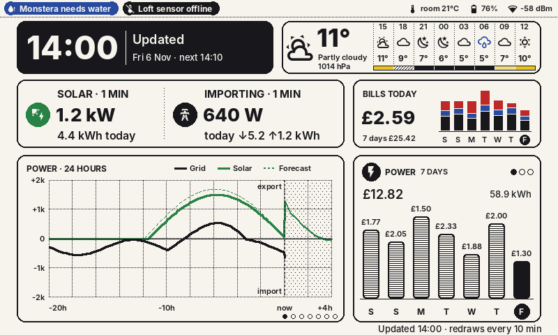 |
| 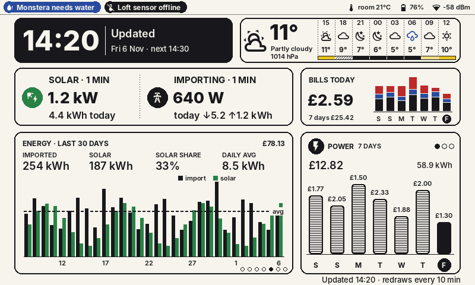 | 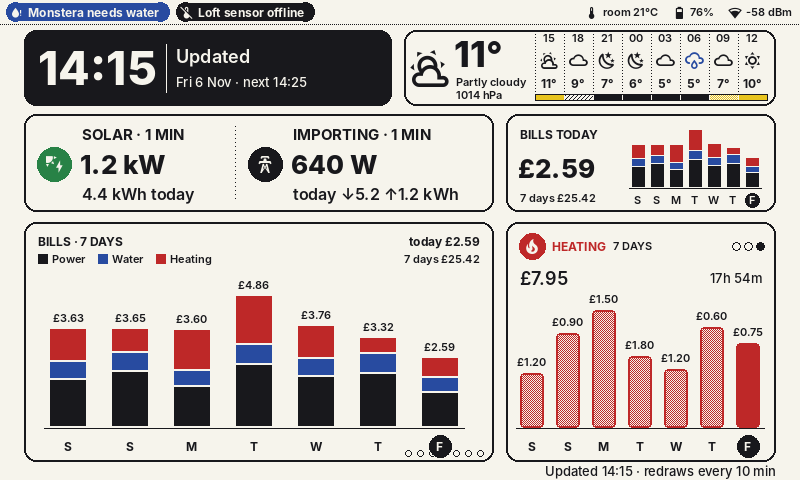 |
| 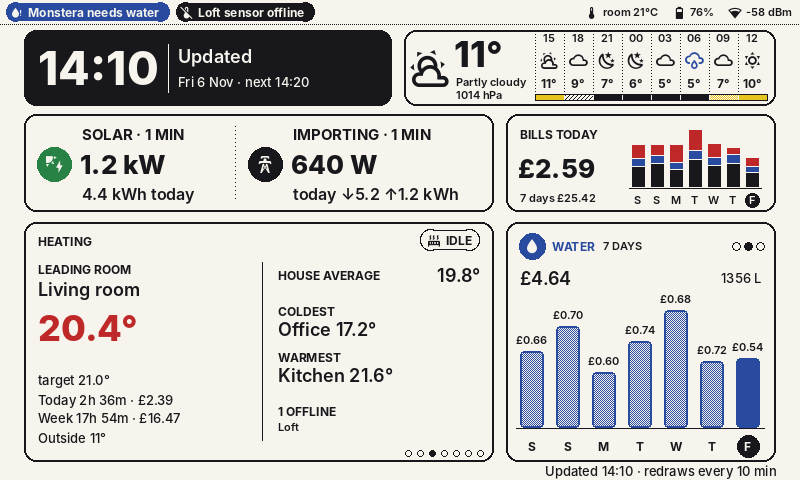 | 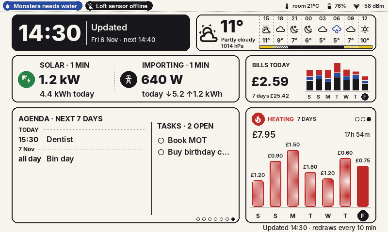 |

`reterminal-e1002-color.yaml` is the DIY layout redrawn for the reTerminal E1002's 7.3" Spectra 6 screen. It uses the same Home Assistant packages as the DIY panel, with its own **E1002 panel refresh**, **card change** and **stay awake** helpers, which `panel_core.yaml` creates.

Each utility has one colour, the same everywhere on the screen, so you can tell at a glance what you're looking at:

| Colour | Utility | Where you'll see it |
| --- | --- | --- |
| ⚫ **Black** | Power | Grid card and line, power bars, power segments in the bills |
| 🔵 **Blue** | Water | Water bars and headings, water segments in the bills, rain and snow in the forecast, the "plants need water" chip |
| 🔴 **Red** | Heating | Heating bars and bill segments, the heating pill, the leading room's temperature, heating alerts |
| 🟢 **Green** | Solar | Solar card, solar line on the chart, solar bars |
| 🌱 **Green + light blue** | Plants | A green leaf and reservoir frames, with light blue (blue and white dots) water |

Figures are black, and lighter shades (dots of colour and white) mark past days next to today's solid bar. Yellow only fills the sunny slots of the forecast strip, which has a black frame. It's never used for text or figures, as it's hard to read on this screen.

The E1002 also adds a few things the XIAO can't do:

- **Battery** – level in the top bar (red under 20 %), and in Home Assistant.
- **Room temperature and humidity** – from the on-board sensor, in the top bar and in Home Assistant.
- **Buttons** – green redraws the screen now and wakes the panel while it sleeps. Left and right step back and forward through the rotating cards. Presses within 1.5 seconds add up to one redraw, so the slow colour refresh only happens once.
- **Night sleep** – the **E1002 panel night sleep** helpers, as described for the [DIY panel](#the-diy-panel).

Colour e-ink can't refresh part of the screen. Every redraw flashes the whole panel through its colours for about 20 seconds, so the E1002 redraws much less often than the black-and-white panels:

- **While awake** it redraws every **E1002 panel redraw (awake)** minutes: 5, 10 (the default), 15, 30 or 60.
- **Alerts redraw early.** It checks every minute, and when an alert appears or clears it redraws straight away, at most once every 2 minutes. That covers Home Assistant going offline, plants needing water, offline room sensors, and heating, electricity and water alerts.
- **The clock shows when the screen was drawn**, with the time of the next redraw underneath, so a slow redraw never shows a wrong time.
- **The green button** always redraws now.
- **While asleep** nothing changes: it wakes on **E1002 panel refresh** and draws once.

For battery life, set **E1002 panel refresh** to 15 minutes or longer.

---

## reTerminal E1001 and TRMNL

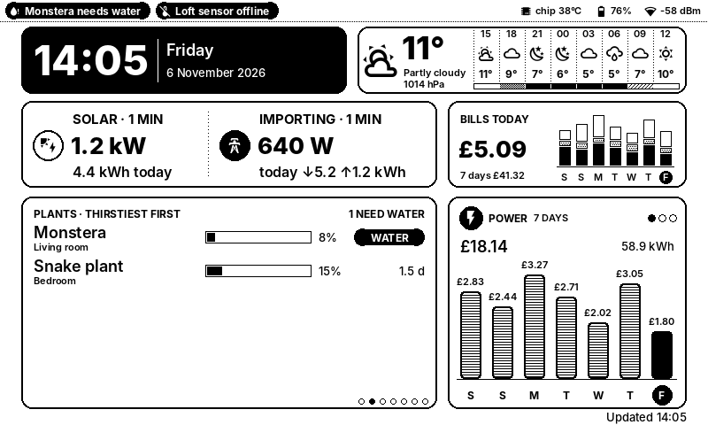

These run the DIY panel's black-and-white layout, with their own hardware set up:

| | reTerminal E1001 | TRMNL 7.5" (OG) DIY Kit | TRMNL OG |
| --- | --- | --- | --- |
| File | `reterminal-e1001.yaml` | `trmnl-7in5-diy.yaml` | `trmnl-og.yaml` |
| Refresh / wake button | Green button | KEY1 (GPIO2) | Hold the button for 1 s |
| Previous / next card | Left / right buttons | KEY2 / KEY3 | Tap the button (next card) |
| Top bar | Battery and room temperature | Battery and chip temperature | Battery and chip temperature |
| In Home Assistant | Battery, room temperature and humidity | Battery | Battery |

Any button press keeps the panel awake for 5 minutes. Night sleep works the same as on the [DIY panel](#the-diy-panel), using each panel's own **… night sleep** helpers.

> **TRMNL OG:** installing this replaces TRMNL's own firmware, so the device stops working with TRMNL's service until you flash TRMNL's firmware back (from usetrmnl.com). The first install has to go over USB: put the TRMNL into flashing mode with its boot button (see TRMNL's flashing guide), then install from the ESPHome dashboard. The pins come from TRMNL's open-source firmware. The TRMNL and the TRMNL DIY Kit share the **TRMNL panel …** settings, as you'd normally have one or the other.

Everything else is the same as the [DIY panel](#the-diy-panel): the same packages, and the same `show_*` switches. Each has its own refresh, card change and stay awake helpers (**E1001 panel …** and **TRMNL panel …**). Black-and-white e-ink refreshes in a few seconds, so these keep the 30-second redraw while awake.

> Every panel has its own settings, so you can run them all with different refresh rates. They're all in `cards/panels-card.yaml`.

---

## Voice commands

The E1003 listens for **"Okay Nabu"** on the device itself. Then say, for example:

- "show heating / plants / agenda / lights / main"
- "heating on", "heating off", "set heating to 21"

The voice assistant pipeline you pick for the panel needs a **speech-to-text** engine. Use **Speech-to-Phrase** (light, ideal for fixed commands) or **Whisper**. Speech-to-Phrase doesn't read `/config/custom_sentences`, so copy `custom_sentences/en/panel.yaml` to `/share/speech-to-phrase/custom_sentences/en/panel.yaml` as well, then restart the add-on.

---

## Troubleshooting

| Problem | Fix |
| --- | --- |
| Panels show different bills | Bills are worked out once in Home Assistant (**Panel Bills**, from `panel_core.yaml` and `custom_templates/panel_bills.jinja`) and every panel draws that, so they agree once all panels run the latest firmware. Today's kWh comes from the **Grid Import Today** meter (`panel_energy.yaml`): on the day you first add it, it only counts from that moment – set it with `utility_meter.calibrate` or wait until midnight |
| A row says "Entity not available" on a card | That feature's package isn't installed, or (for water) the tariff helpers don't exist yet |
| Panel taps do nothing in Home Assistant | Tick "Allow the device to perform Home Assistant actions" for the panel |
| The screen didn't change after an install | Check the version tag in the Home footnote. If it's old, the install failed or the panel was asleep: press green, then install again (or use ⋮ → Clean build files) |
| "No text recognised" for voice | Your speech-to-text engine doesn't know the commands. See [Voice commands](#voice-commands) |
| Month or day labels look wrong | The panel works them out itself when Home Assistant sends none. Update `custom_templates/panel_stats.jinja` and restart |
| A Lights room is missing | It needs a light or a `panel_device` entity in that area |
| Heating shows "No rooms yet" | Give your areas a temperature sensor and make sure `panel_core.yaml` is installed |
| Log warnings about duplicate keys | You're on an old package. Copy the current files and restart |

---

## Updating

1. Copy the new `homeassistant/` files over yours, keeping your YOUR SETTINGS blocks (the comments make them easy to spot), then restart Home Assistant.
2. Install the new ESPHome YAML, keeping your `substitutions:` values.
3. Check the version tag in the Home footnote.

Some updates change what Home Assistant sends to the panels. Always update both sides together.

---

## Coming next

This is far from finished. Here's what's on my list:

- **Individual PV panel monitoring** – per-panel output from microinverters or optimisers, so you can spot a shaded or failing panel straight from the Energy page.
- **Smart plant sensors** – support for soil sensors that read moisture and probe temperature. Plants with a sensor will use real soil readings instead of the virtual reservoir and the room temperature.
- **Battery storage management** – charge level, charge and discharge power, and controls for charging on cheap tariffs. This builds on the battery size suggestion that's already in the Energy page.
- **Gas usage** – gas meter readings and costs next to power, water and heating, including in Bills Today and the alerts.

Got a device you'd like supported, or an idea for the panels? Open an issue.

---

More projects, write-ups and the story behind this build at [notenoughtech.com](https://notenoughtech.com).
